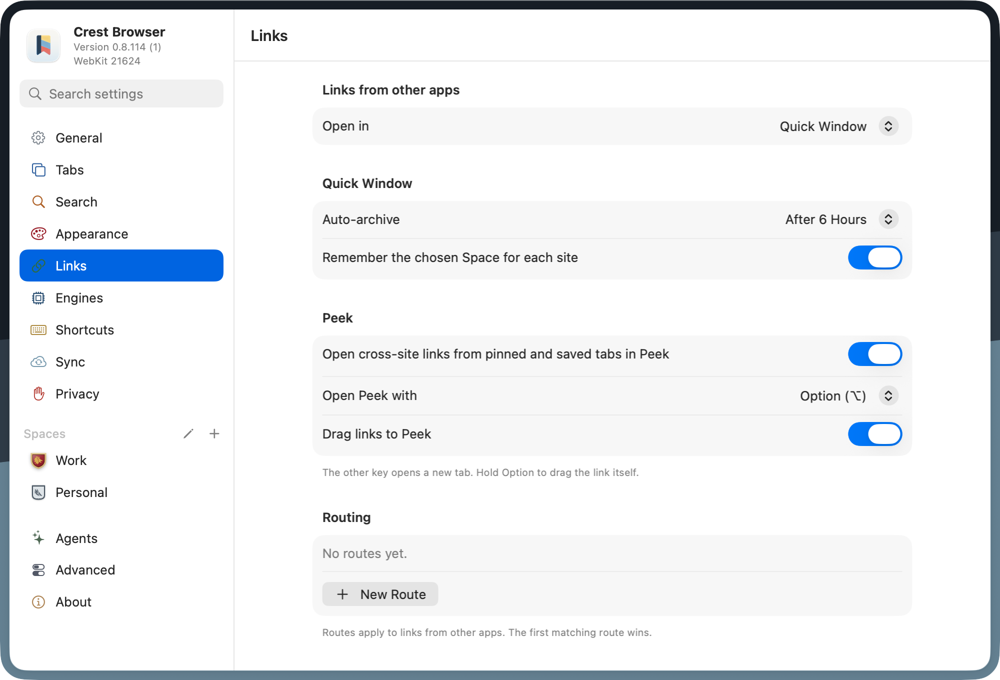
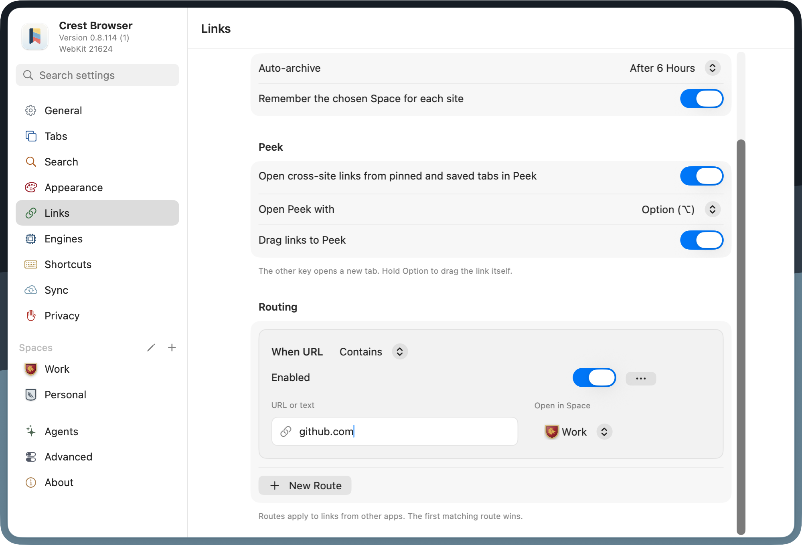

import createRoute from './link-routing/create-route.mp4';

Link Routing is Crest’s equivalent of Arc’s Air Traffic Control: matching links opened from other apps can go to a specific Space before the normal external-link destination is considered.

## Create a route

1. Open **Settings → Links**.
2. In **Routing**, choose **New Route**.
3. In **URL or text**, enter a URL pattern.
4. Next to **When URL**, choose **Contains** or **Is Exactly**.
5. In **Open in Space**, choose the destination Space.

<video
  src={createRoute}
  aria-label="Creating a route in Settings, Links: New Route, Contains, github.com, Work"
  className="rounded-lg"
  autoPlay
  muted
  loop
  playsInline
  controls
/>

Routes are evaluated from top to bottom. Reorder them when a narrow rule should win before a broad one.

## Match deliberately

- **Is Exactly** is best for one complete address that should always land in one Space.
- **Contains** is useful for a domain or stable path fragment, but a pattern that is too broad may catch unrelated links.

Start with the smallest meaningful domain or URL fragment, test a link from another app, then broaden only if needed.

## Relationship to Quick Window

Routing runs before the default **Links from other apps** choice. If no rule matches, Crest uses Quick Window, Most Recent Space, or the Chosen Space according to that default.

A route targeting a protected Private Space is hidden until that Space is unlocked. This prevents its URL patterns and destination identity from leaking through Settings.

